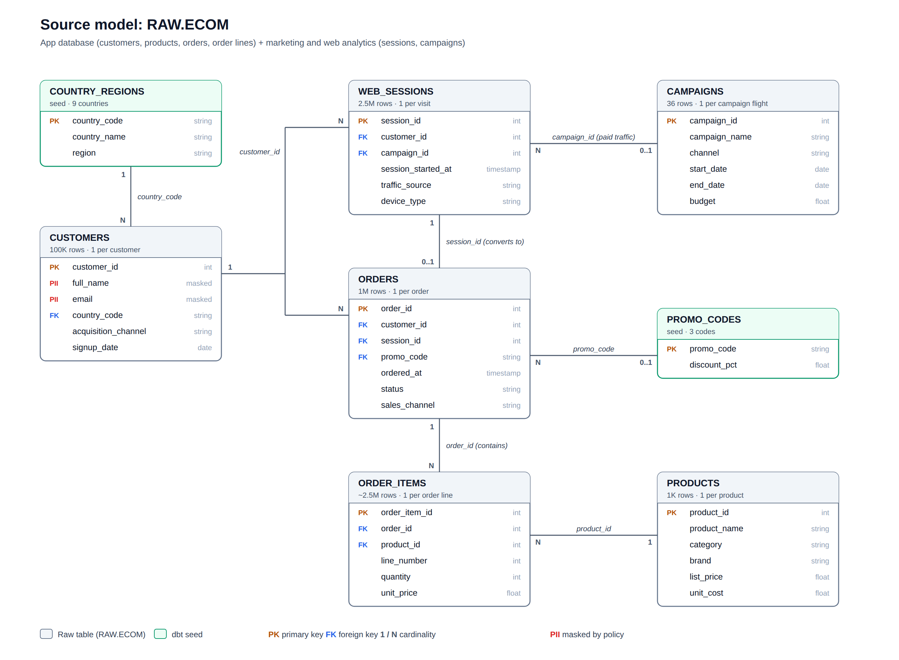
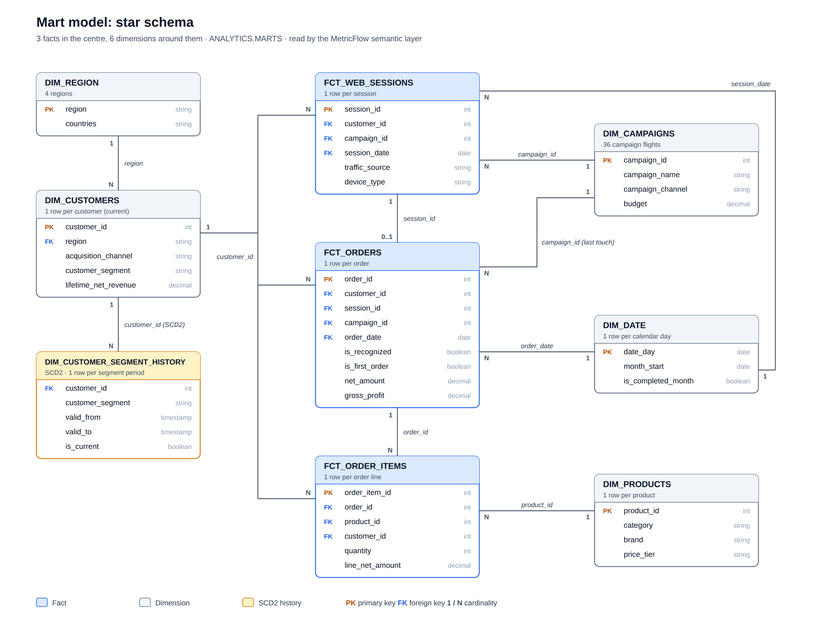
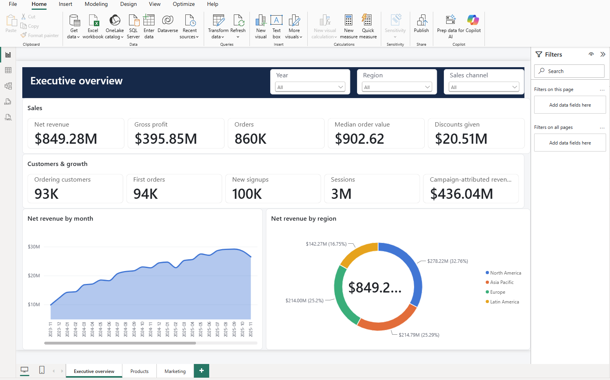
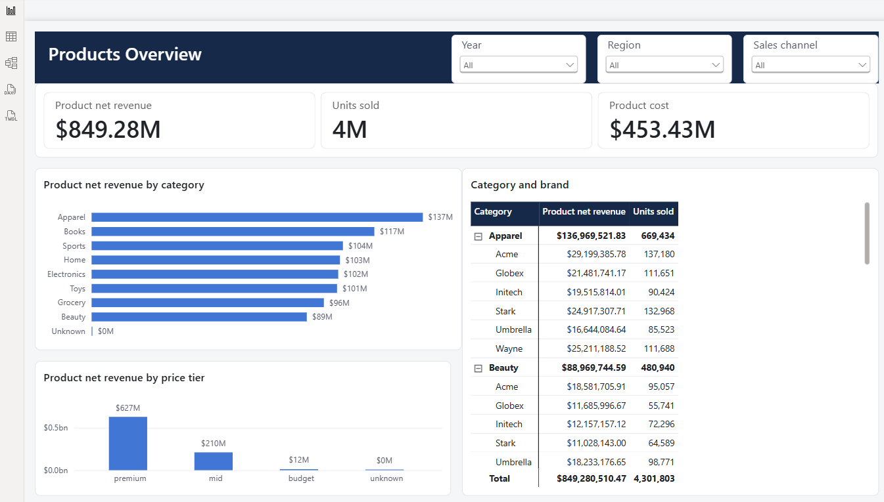
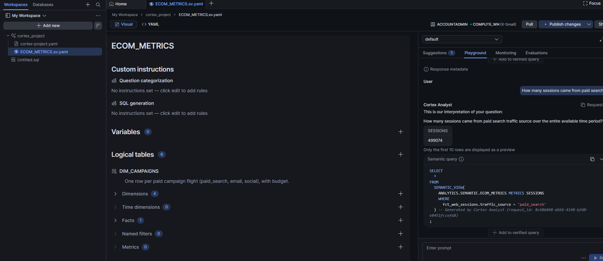

# AI-Ready Semantic Layer: one certified definition per metric, served everywhere

**Business problem:**
Online retailer selling about 1,000 products through a website and a mobile app, to customers in 9 countries across 4 regions (North America, Europe, Asia Pacific, Latin America). It runs paid campaigns on search, email and social, and has 3 years of history.

**The problem: the same question gets different answers. This is the most common reason companies build a semantic layer:**

- **What counts as revenue?** Finance counts only completed and shipped orders, net of discounts. Marketing's dashboard includes placed orders. A regional analyst's spreadsheet forgets returns. Each team reports a different "revenue" in the same meeting.
- **Ratios get averaged wrong.** One dashboard averages daily AOV, another divides total revenue by total orders. They disagree, and nobody knows which is right.
- **Marketing can't prove ROI.** Campaign spend sits in one system and orders in another, and attribution logic is copied by hand into every report.

**The solution:** Define every metric once, in code, in dbt, with tests and an owner.

Compute it with MetricFlow, and serve the same certified numbers to Power BI, to Snowflake and to AI assistants. A change to a definition goes through a pull request and CI, never through someone editing a dashboard.

**Stack:** Snowflake · dbt Core + MetricFlow · GitHub Actions CI/CD · Power BI (DAX) · Snowflake semantic view + Cortex Analyst · LangGraph + Claude agent via MCP

> **Headline result.** Same model (Claude Haiku 4.5), same 20 questions × 3 runs, same rules:
> the agent that uses the semantic layer answered **88%** correctly with **0%** hallucinated numbers;
> the same agent writing raw SQL on the same tables answered **46%** correctly, and **13%** of its answers contained unsupported numbers.
> [Details below](#ai-accuracy-evaluation).

## Architecture


## Data sources

The data imitates a real online store that sells about 1,000 products through a website and a mobile app, to customers in 9 countries, with 3 years of history. It comes from two places, just like at a real company:

- **The store's app database:** customers, products, orders, and the order lines (one line per product in an order)
- **Marketing and web analytics:** website and app visits (sessions), and the paid campaigns that drove them

| Table (`RAW.ECOM`) | Rows | One row per |
|---|---|---|
| customers | 100,000 | customer |
| products | 1,000 | product |
| campaigns | 36 | campaign (3 channels × 12 quarters) |
| web_sessions | 2,500,000 | website or app visit |
| orders | 1,000,000 | order |
| order_items | ~2,500,000 | product line inside an order |

Two small reference files (dbt seeds) map each country to its region and each promo code to its discount.

The data is synthetic, generated inside Snowflake with SQL (`snowflake/02_generate_data.sql`), and tuned to behave like real data: signups grow over time, email converts best, about 4% of orders are returned, and no visit happens before a customer signs up.

Customer names and emails are personal data (🔒 PII), so a Snowflake policy masks them, and they never reach the reporting tables.



## Data modeling with dbt

Raw data isn't ready for reporting. Orders have no money columns, customers have no region, and nothing says which orders count as revenue. dbt turns it into clean, tested tables in four steps:

1. **Staging: clean the raw data.** One view per source table that renames columns, fixes data types and tags personal data. Nothing is joined yet.
2. **Intermediate: prepare the tricky logic.** Works out which segment each customer was in on any given date: prospect (0 orders), one-time (1), repeat (2–14) or loyal (15+).
3. **Snapshot: keep history.** Records every time a customer changes segment (SCD Type 2), so we can ask "which segment was this customer in when they ordered?"
4. **Marts: build the star schema.** The final tables that dashboards, the semantic layer and the AI agent read.

The marts follow a **star schema**:

- **Facts** (the centre) record what happened, with the numbers:
  - `fct_web_sessions`: one row per visit (2,500,000)
  - `fct_orders`: one row per order, with revenue, discount, cost and profit calculated once (1,000,000)
  - `fct_order_items`: one row per product in an order (2,499,961)
- **Dimensions** (around them) describe who, what, where and when: customers, customer segment history, products, campaigns, dates and regions. Each has an **unknown member (−1)**, so no fact row is lost when a key doesn't match.

**Business rules are decided once, here, and every report inherits them:**

- Only **completed or shipped** orders count as revenue (`is_recognized`)
- Each order is credited to the campaign behind the visit that led to it (last touch)
- Personal data never reaches the marts

**Tests guard every table:** contracts lock each core table's columns and types, unit tests check the business logic, and data tests check keys, ranges and totals. For example, one test proves the order lines add up exactly to the order totals.



<!-- 📸 PICTURE: dbt lineage graph (dbt docs generate + serve) -> docs/images/dbt_lineage.png -->

## Semantic layer (MetricFlow)

On top of the marts, **MetricFlow** defines **20 certified metrics** across **6 semantic models** (orders, order items, customers, products, sessions, campaigns), plus a daily time spine. Examples: `net_revenue`, `recognized_orders`, `gross_merchandise_value`, `gross_profit`, `product_net_revenue`, `units_sold`, `new_signups`, `customer_lifetime_value`, `campaign_spend`, `campaign_attributed_revenue`.

Each semantic model declares its join keys (entities), so MetricFlow joins tables safely by itself. Business rules live inside the metric: `net_revenue` = `sum(net_amount)` **only for recognized orders**, defined once and inherited by Power BI, Snowflake and the agent.

**Proof that the layer is consistent:** net revenue = **849,280,510.47**. Revenue by product category, by sales channel and by year all add back to that total to the cent. Recognized orders by year sum to 859,939, and signups by country sum to 100,000 ([docs/semantic_layer.md](docs/semantic_layer.md)).

<!-- 📸 PICTURE: terminal running `mf query --metrics net_revenue --group-by product__category` -> docs/images/mf_query.png -->

## What makes the numbers trustworthy

- **Defined once:** every metric lives in dbt YAML with an owner, grain, refresh SLA and business definition, and is computed by MetricFlow outside Snowflake.
- **Locked structure:** core tables have enforced contracts, so a breaking column change fails CI before it reaches a dashboard.
- **Tested logic:** unit tests and business-rule tests guard the calculations, and slim CI on Snowflake rebuilds only what a pull request changed.
- **Protected data:** PII is masked at the source, and row access policies limit each regional analyst to their own region.
- **Reconciled reporting:** Power BI shows the certified metrics plus a DAX dashboard checked against them, and every page traces back to the raw data.

## CI/CD (GitHub Actions)

- **pre-commit** on every commit: SQLFluff, gitleaks, private-key detection, and a block on `.env` / key files.
- **CI on every pull request**, in 4 visible jobs: (1) lint + secrets, (2) dbt parse + MetricFlow validation, (3) dbt build + tests on Snowflake, (4) semantic layer vs warehouse check.
- **Slim CI:** builds only modified models and their children (`state:modified+ --defer`), using the prod manifest artifact.
- **Prod deploy** on merge to `main` and weekly: freshness, build, MetricFlow validation, smoke query, and the manifest is published for slim CI.
- Per-PR schemas (`ci_pr_<n>`) are dropped automatically when the PR closes.

<!-- 📸 PICTURE: GitHub PR with the 4 CI checks passing -> docs/images/ci_checks.png -->

## Power BI report

Power BI reads the dbt marts (star schema) and mirrors the 20 MetricFlow metrics as DAX measures, verified to match MetricFlow (see [powerbi/reconciliation.md](powerbi/reconciliation.md)).

The model and report are saved as **PBIP/TMDL** (plain text, version-controlled), and the measures were built through the **Power BI Modeling MCP server** driven by Claude Code.



<!-- 📸 PICTURE: Marketing page -> docs/images/img3.png -->

## Snowflake semantic view and Cortex Analyst

- `scripts/build_snowflake_ossie.py` converts dbt's `semantic_manifest.json` into an Ossie model, and `SYSTEM$CREATE_SEMANTIC_VIEW_FROM_OSSIE_YAML` creates **`ANALYTICS.SEMANTIC.ECOM_METRICS`** (6 tables, 6 relationships, 20 metrics).
- **dbt stays the single source of truth.** The Snowflake semantic view is generated from it, never hand-written.
- **Cortex Analyst** answers plain-English questions over the view, using only the certified metrics.



## Secure agent access

Every request from the agent passes four checks, in this order:

| Check | Control |
|---|---|
| **Where** | Network policy: only an allow-listed IP (`/32`) can use the agent's login |
| **Who** | `AGENT_SVC` service user (no password) + programmatic access token (30-day expiry) |
| **What** | `AGENT_READER` role: read-only on marts and the semantic view; no staging, raw or writes |
| **How** | SQL guard in code: a single read-only statement over the semantic view only |

- A **Snowflake managed MCP server** (`ECOM_METRICS_MCP`), created with one SQL statement, exposes `ask_metrics` (Cortex Analyst).
- Trial accounts block the `SYSTEM_EXECUTE_SQL` tool, so SQL runs through the **Snowflake SQL API** with the same token, role and network policy, plus the guard.
- Secrets live only in `.env`. Logs redact tokens and API keys automatically.

<!-- 📸 PICTURE: Snowflake Query History showing a query run by AGENT_SVC with role AGENT_READER -> docs/images/agent_query_history.png -->

## Metrics Analyst agent

- **LangChain `create_agent` running on LangGraph**, with Claude Haiku 4.5, a system prompt of answer rules, per-conversation memory and a step limit.
- **Tools:** `ask_metrics` (MCP → Cortex Analyst writes SQL from certified metrics) and `run_metric_sql` (guarded execution).
- **Rules:** every number must come from a tool result; cite the metric and its definition; state assumptions; label its own arithmetic; refuse out-of-scope questions and personal data.
- A terminal chat with step-by-step logs: each tool call, tokens and timings.

<!-- 📸 PICTURE (GIF works best): agent answering "What is net revenue by product category?" with its log lines -> docs/images/agent_demo.gif -->

## AI accuracy evaluation

**Does a semantic layer make AI answers more accurate?** Two systems answer the same exam:

- **S1, semantic layer agent:** the Metrics Analyst above
- **S2, raw text-to-SQL:** the same model, rules and step limit, but it sees only table and column names and writes its own SQL

**Method:**
- **20 frozen questions in 5 types:** same metric in different words, slice/filter, ambiguous, derived (% / share / difference), out of scope.
- **Ground truth from MetricFlow** (`eval/ground_truth.json`), independent of the agent, Cortex and the semantic view.
- **3 runs per question**, a fresh conversation each time, every tool call recorded.
- **Scoring:** numbers are checked by code (with tolerance); behaviors (refused, asked to clarify, stated an assumption, labeled arithmetic) are checked by an LLM judge, with a human spot-check.

| Metric | S2: Raw text-to-SQL | **S1: Semantic layer agent** |
|---|---|---|
| Answer accuracy | 46% | **88%** |
| Hallucination rate | 13% | **0%** |
| Metric selection accuracy | n/a | **100%** |
| Correct refusal rate | 67% | **75%** |
| Consistency (passes all 3 runs) | 40% | **75%** |

\* S1 passed the ambiguous questions mainly by asking a clarifying question.

**Why raw SQL struggles:** rules like "net revenue only counts recognized orders" are invisible in a table schema, so the model has to guess them. 

**The semantic layer encodes them once, and every consumer inherits them.**

## How this was built
 
Built with AI-assisted development (Claude and Claude Code). I designed the architecture, ran and verified every step on Snowflake, and own the results. AI was used as a pair programmer: for explaining concepts, drafting code that I reviewed and tested, and building the Power BI measures through the Power BI Modeling MCP server. Every number in this README was checked against MetricFlow.

### Next steps
- **Agent v2:** rename `orders` → `all_orders`, give the agent the real metric catalog, fix the tool description, convert dates, tighten prompt rules, then re-run the eval.
- Human-in-the-loop approval for agent actions (e.g. saving or sending a report).

## Repository structure
```
models/                 dbt staging, intermediate, marts (+ semantic models and metrics in YAML)
seeds/                  country -> region, promo code -> discount
macros/                 helpers (e.g. dropping CI schemas)
snowflake/              setup SQL: data generation, BI access, MCP server
scripts/                build_snowflake_ossie.py, test_mcp.py
powerbi/                PBIP report (TMDL model + PBIR pages), theme, reconciliation
agent/                  Snowflake client, tools, prompts, agent, raw-SQL baseline, CLI, logging
eval/                   questions, ground truth, runner, scorer, results
docs/                   semantic_layer.md, agent_findings.md, images/
.github/workflows/      ci.yml, prod.yml, ci_cleanup.yml
```

## Run it
```bash
conda activate semantic-layer
pip install -r requirements.txt

dbt build --target prod                  # models + tests
mf query --metrics net_revenue           # semantic layer
python -m agent.cli                      # chat with the agent
python eval/run_agent_eval.py            # eval S1 (add --system s2 for the raw-SQL baseline)
python eval/score.py eval/results/S1_agent_v1.jsonl
```
Requires a `.env` (never committed) with `SNOWFLAKE_ACCOUNT_URL`, `SNOWFLAKE_MCP_URL`, `SNOWFLAKE_MCP_PAT` and `AGENT_ANTHROPIC_API_KEY`.
